# AB Asset Tracker

[](https://patreon.com/IvanS1123)

A **Loans** section for a self-hosted [Actual Budget](https://actualbudget.org)
server. It follows each of your loans (mortgages, car loans, personal loans)
and what they paid for: payment number, principal vs. interest, payoff date,
and equity, meaning what the home or vehicle is worth minus what you still
owe. Each month you match the payment that synced into Actual, and the
schedule stays in step with your lender.

It's an add-on that sits in front of Actual. Actual itself is never modified
and the tracker never writes to your budget. It is a community project, not
affiliated with or endorsed by the Actual Budget project.

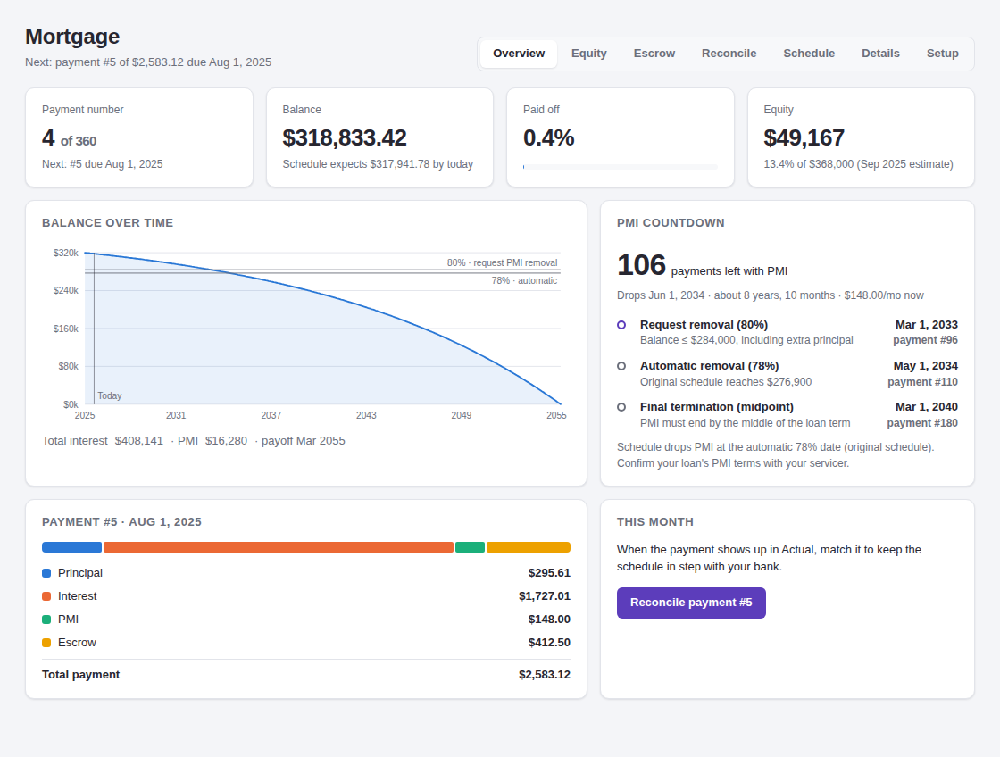

> All numbers in this README, the screenshots, the tests, and the sample files are made up.

---

## Contents

- [Install](#install)
- [Update](#update)
- [Uninstall](#uninstall)
- [What it does](#what-it-does)
- [Using it](#using-it)
- [Configuration reference](#configuration-reference)
- [How it works](#how-it-works)
- [Support the project](#support-the-project)

More documentation:

- [FAQ](docs/FAQ.md)
- [Troubleshooting](docs/TROUBLESHOOTING.md)
- [Read-only summary endpoint](docs/SUMMARY_ENDPOINT.md)
- [Compatibility](docs/COMPATIBILITY.md)
- [Development](docs/DEVELOPMENT.md)
- [Known limitations](docs/KNOWN_LIMITATIONS.md) and the [roadmap](docs/ROADMAP.md)

---

## Install

About 10 minutes. You only do this once.

### Before you start

You need:

- [ ] A Linux, macOS or Windows machine (a Raspberry Pi works) with **Docker**
      and the **Compose plugin**. Check with `docker compose version`.
- [ ] **git**. Check with `git --version`.
- [ ] Your **Actual server password**, the one on Actual's login screen.
- [ ] Your budget's **Sync ID**: in Actual, *Settings → Show advanced
      settings → Sync ID*. (On a fresh install you get it in step 6.)

Then pick your setup:

| | Setup | Pick it if |
|---|---|---|
| **A** | **Existing Actual** | You already run Actual on this machine, for example from its own Docker container on port 5006. Most people. Your Actual container isn't touched. |
| **B** | **Fresh install** | You don't run Actual yet. This starts Actual and the add-on together. |

Reach Actual through a **Cloudflare Tunnel** or your own HTTPS reverse
proxy? Pick A or B as usual, and read
[Behind a Cloudflare Tunnel or another HTTPS proxy](#behind-a-cloudflare-tunnel-or-another-https-proxy)
before step 3.

### Step 1: Download

```sh
git clone https://github.com/gismc123/AB-Asset-Tracker.git ab-asset-tracker
cd ab-asset-tracker
```

### Step 2: Create your settings file

```sh
cp .env.example .env
mkdir -p data certs
```

### Step 3: Fill in `.env`

Open `.env` in any editor (for example `nano .env`) and set these lines.
Leave everything else as it is.

**Setup A (existing Actual)**, for an Actual on the same machine on port 5006:

```ini
COMPOSE_FILE=compose.existing-actual.yml
ACTUAL_SERVER_URL=https://actual:5006
ACTUAL_UPSTREAM=https://actual:5006
ACTUAL_PASSWORD=your-actual-server-password
ACTUAL_SYNC_ID=your-budget-sync-id
TZ=Europe/Berlin
```

- Write `http://` instead of `https://` in both URLs if your Actual uses
  plain HTTP.
- Keep the host name `actual`: it means "this machine" inside the
  containers. If Actual runs on another machine, use its address instead
  (for example `https://192.0.2.10:5006`).
- If Actual uses a self-signed certificate, see
  [Actual's certificate is self-signed](#actual-uses-a-self-signed-certificate).

**Setup B (fresh install):**

```ini
COMPOSE_FILE=docker-compose.yml
ACTUAL_SERVER_URL=http://actual:5006
ACTUAL_UPSTREAM=http://actual:5006
TZ=Europe/Berlin
```

Leave `ACTUAL_PASSWORD` and `ACTUAL_SYNC_ID` empty for now; you fill them in
at step 6. Also create the folder for Actual's data: `mkdir -p actual-data`.

`TZ` is your timezone as a [tz database name](https://en.wikipedia.org/wiki/List_of_tz_database_time_zones)
(it decides what "today" is). `COMPOSE_FILE` tells Docker Compose which
setup you chose, so every command from here on is plain `docker compose`.

### Step 4: Start it

```sh
docker compose up -d
```

The first start builds two small images, which takes a few minutes (longer
on a Raspberry Pi). Later starts take seconds.

### Step 5: Open it

Open **`https://<this-machine>:5007`** in your browser. That's port **5007**,
the add-on's port, not Actual's 5006.

Your browser warns about the certificate the first time, because the add-on
made its own. Accept it to continue, or
[use a real certificate](#use-a-real-certificate).

Behind a Cloudflare Tunnel or your own HTTPS proxy, open your public name
instead (for example `https://budget.example.com`), once the tunnel points
at port 5007.

Log in to Actual as usual. **Loans** appears in the sidebar.

### Step 6 (setup B only): Create your budget, then connect the tracker

1. In the page from step 5, set your Actual password and create (or import)
   your budget, as on any new Actual server.
2. Copy the Sync ID (*Settings → Show advanced settings → Sync ID*).
3. Put the password and Sync ID in `.env`:
   ```ini
   ACTUAL_PASSWORD=the-password-you-just-set
   ACTUAL_SYNC_ID=the-sync-id-you-copied
   ```
4. Run `docker compose up -d` again.

### Step 7: Check it worked

```sh
docker compose ps
docker compose logs asset-tracker-backend | grep asset-tracker
```

`docker compose ps` should show `asset-tracker-backend` as *healthy* and
`asset-tracker-proxy` as *running*. The log should end with
`[asset-tracker] connected to Actual and loaded the budget`.

If it doesn't, the log line above it says what's wrong; see
[Troubleshooting](docs/TROUBLESHOOTING.md).

### Step 8: Add your first loan

Click **Loans** in Actual's sidebar. The welcome screen asks what kind of
loan to add, then shows only the fields that kind needs.

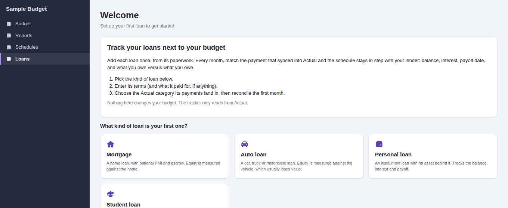

 Have your loan paperwork or a recent statement at hand. See [Adding a loan](#adding-a-loan)
for what each field means.

> **All set?** AB Asset Tracker is free and built in spare time. If it's
> useful to you, you can chip in on [Patreon](https://patreon.com/IvanS1123).
> It's entirely optional; every feature is free either way.

---

### Behind a Cloudflare Tunnel or another HTTPS proxy

Many people reach Actual from outside their home through a **Cloudflare
Tunnel**: `cloudflared` sends a public name such as `budget.example.com` to
Actual on the home server (for example `http://192.0.2.10:5006`), and
Cloudflare handles the HTTPS certificate. The same goes for your own reverse
proxy (Caddy, Traefik, Nginx Proxy Manager) or Tailscale Serve.

That works with the add-on too. Only two things change: the tunnel points
at the add-on's port (5007) instead of Actual's, and you tell the add-on
that something in front already handles HTTPS.

```
 browser ──HTTPS──▶ Cloudflare ──tunnel──▶ cloudflared ──▶ add-on proxy :5007 ──▶ Actual :5006
                    (certificate)                              │
                                                               └──▶ tracker backend ──▶ Actual
```

Everything still goes through the one public name: Actual, the Loans
screens and the tracker's API. Actual itself doesn't change.

**1. Point the backend at Actual on your network**, not at the public name.
Use the same address your tunnel uses for Actual today. For an Actual on
this machine on plain HTTP, with setup A:

```ini
ACTUAL_SERVER_URL=http://actual:5006
ACTUAL_UPSTREAM=http://actual:5006
```

If Actual runs on another machine, use its address instead, for example
`http://192.0.2.10:5006`. Don't use `https://budget.example.com` here: every
request would leave your network and come back, and if the name is
protected by Cloudflare Access, the backend gets a login page instead of
your budget.

**2. Pick how the tunnel talks to the add-on.**

| | Use it if | In `.env` | Tunnel service |
|---|---|---|---|
| **Plain HTTP** (recommended) | You open Actual only through the Cloudflare name. | `PROXY_TLS=off` | `http://<this-machine>:5007` |
| **HTTPS** | You also want to open `https://<this-machine>:5007` at home. | `PROXY_TLS=on` (the default) | `https://<this-machine>:5007`, with **No TLS Verify** on |

`<this-machine>` is the address `cloudflared` uses to reach the add-on:
`localhost` when `cloudflared` runs on this machine as a system service (or
in Docker with host networking), otherwise this machine's network address,
such as `192.0.2.10`.

With plain HTTP, the add-on's port shouldn't be open to everyone on your
network. When `cloudflared` runs on this machine, also set
`PROXY_PORT=127.0.0.1:5007`, so only this machine can reach it. Actual
refuses to run on plain `http://` addresses other than `localhost` anyway,
so with `PROXY_TLS=off` you always open it through the Cloudflare name.

**3. Apply it:** `docker compose up -d`. The proxy log
(`docker compose logs asset-tracker-proxy`) says `TLS: off` or `TLS: on`.

**4. Change the tunnel.** In the Cloudflare dashboard, open *Zero Trust →
Networks → Tunnels*, pick your tunnel, and edit the public hostname you use
for Actual (Cloudflare also calls it a *published application route*):

- **Plain HTTP:** set the service type to `HTTP` and the URL to
  `<this-machine>:5007`.
- **HTTPS:** set the type to `HTTPS` and the URL to `<this-machine>:5007`,
  then under *Additional application settings → TLS* turn on **No TLS
  Verify**. The add-on's certificate is self-signed; the part you see in
  the browser is still Cloudflare's certificate.

If you run `cloudflared` from a `config.yml` instead, change the service of
Actual's hostname, then restart `cloudflared`:

```yaml
ingress:
  - hostname: budget.example.com
    service: http://localhost:5007        # plain HTTP
    # or, with PROXY_TLS=on:
    # service: https://localhost:5007
    # originRequest:
    #   noTLSVerify: true
  - service: http_status:404
```

**5. Open `https://budget.example.com`**, log in as usual, and **Loans** is in
the sidebar. If it isn't, hard-reload once (Ctrl+Shift+R / Cmd+Shift+R):
Actual's page may be cached from before.

Good to know:

- **Cloudflare Access** keeps working. It's one address, so the login
  Cloudflare gives your browser also covers the Loans screens.
- **The summary endpoint** is on the public name too once `SUMMARY_TOKEN`
  is set, so use a long random token. A dashboard at home should call the
  add-on on your network instead (`http://192.0.2.10:5007/...` with plain
  HTTP). Cloudflare Access would block it on the public name.
- **Rocket Loader**: if it's turned on for your domain and Loans never
  appears, turn it off for this hostname. It changes how pages load their
  scripts.
- **Another reverse proxy** works the same way: point it at
  `http://<this-machine>:5007` with `PROXY_TLS=off`, keep WebSocket support
  on, and let it pass `X-Forwarded-Proto` along.

---

## Update

From the `ab-asset-tracker` folder:

```sh
git pull
docker compose up -d --remove-orphans
```

That rebuilds whatever changed and restarts only the add-on (and, for setup
B, Actual if its image changed). When an update changes the database layout,
the tracker first saves a copy of the old database next to it, named
`*.backup-v<N>-<time>`, and logs where it is.

**Updating Actual:** setup A, update Actual the way you always have; the
add-on doesn't need anything. Setup B: `docker compose pull actual && docker compose up -d actual`.

---

## Uninstall

From the `ab-asset-tracker` folder:

```sh
docker compose down --rmi local
```

That removes the add-on's containers and images. Your Actual server and
budget aren't affected (for setup B, Actual's own container stops too, and
its data stays in `actual-data/`). Keep `data/` if you might come back;
otherwise delete the folder.

If you used setup A, keep using Actual on its own port (5006) as before.

---

## What it does

**Loans** sits in Actual's sidebar under the regular items, with each loan
listed beneath it the way Actual lists accounts: equity is the headline
number, and what you owe is underneath. Click a loan to open it.

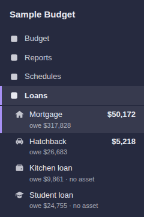
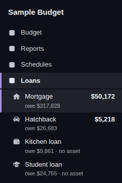

Every loan is one of three types. The type only decides which parts are
switched on; the math underneath is the same amortizing loan.

| Type | Optional parts | Equity is measured against | Its value screen |
|---|---|---|---|
| **Mortgage** | PMI, escrow (both on by default, each can be turned off) | The home | **Equity** |
| **Auto loan** | none | The vehicle, with an optional depreciation curve | **Vehicle** |
| **Personal loan** | none | Nothing by default; you can add an asset | **Totals** (or **Asset**) |

Each loan has these screens:

| Screen | What you see |
|---|---|
| **Overview** | Payment number (e.g. *4 of 360*), balance, percent paid, equity, a balance chart, and either the PMI countdown (mortgages with PMI) or a payoff card: payments left, payoff today, total interest and fees. |
| **Equity / Vehicle / Asset / Totals** | The asset's value, what you owe, equity and loan-to-value; how the equity was built; equity over time and milestones; the asset's value history; and a table of principal, interest, fees, PMI and escrow for this month, this quarter, the year, the loan so far and the life of the loan. A loan without an asset shows just the table and a button to add one. |
| **Escrow** | Mortgages with escrow only. Escrow from each payment, the tax and insurance bills paid from it, a running balance, totals by year, and whether a year of collections covers a year of bills. |
| **Reconcile** | One month at a time. Pick the loan's category, click the matching transaction, and the month is marked paid. If the amount is off, you're asked why. You can also mark a month as skipped here. |
| **Schedule** | Every payment: due date, principal, interest, extra principal, PMI, escrow and fees where the loan has them, total, balance, and status (*scheduled*, *flagged*, *paid*, *skipped*, or *before tracking*). Click any row to reconcile it. |
| **Details** | Reference details that fit the loan type: servicer, account number, lender, insurance, and for a mortgage the property, tax parcel and PMI certificate, or for a vehicle the VIN and plate. Plus notes and fields of your own. |
| **Setup** | The loan terms you enter once, with a live preview, plus rename, archive and delete. |

### Example: a mortgage

A $320,000 loan at 6.5% for 30 years on a $355,000 home, with $148 a month
of PMI and $412.50 of escrow. The payment is **$2,583.12**: $2,022.62 of
principal and interest, plus PMI and escrow. After four payments the balance
is $318,833.42. A September online estimate puts the home at $368,000, so
equity is **$49,167**. PMI is scheduled to come off in June 2034, 106
payments from now.

**Reconcile.** Match the payment that synced into Actual. When it differs
from the schedule, pick what the difference is:

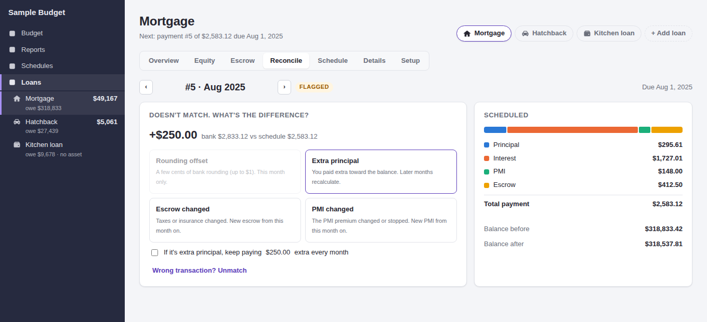

<details>
<summary><b>Equity</b>, <b>Escrow</b> and <b>Schedule</b> screens</summary>

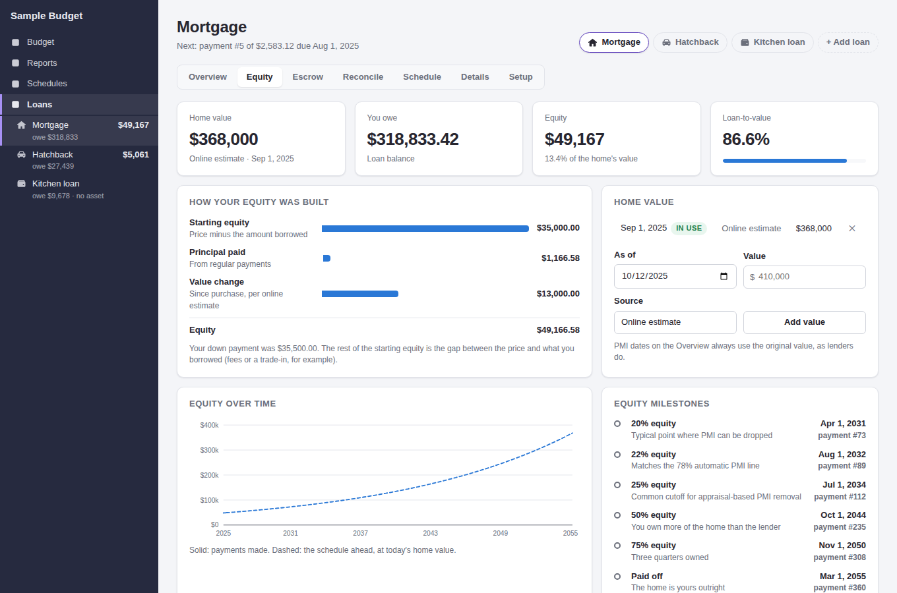

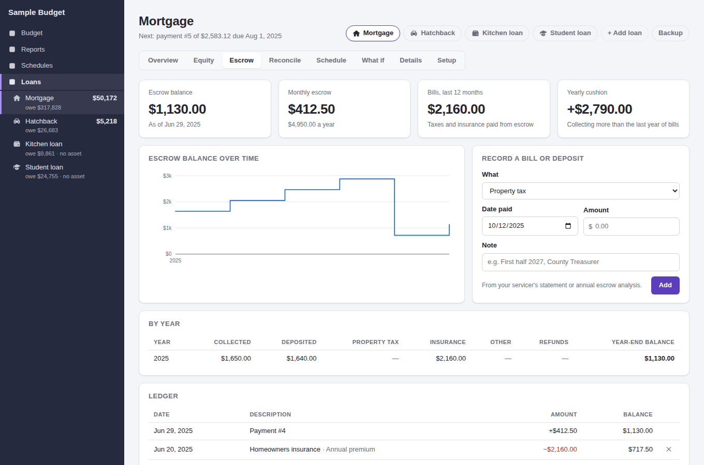

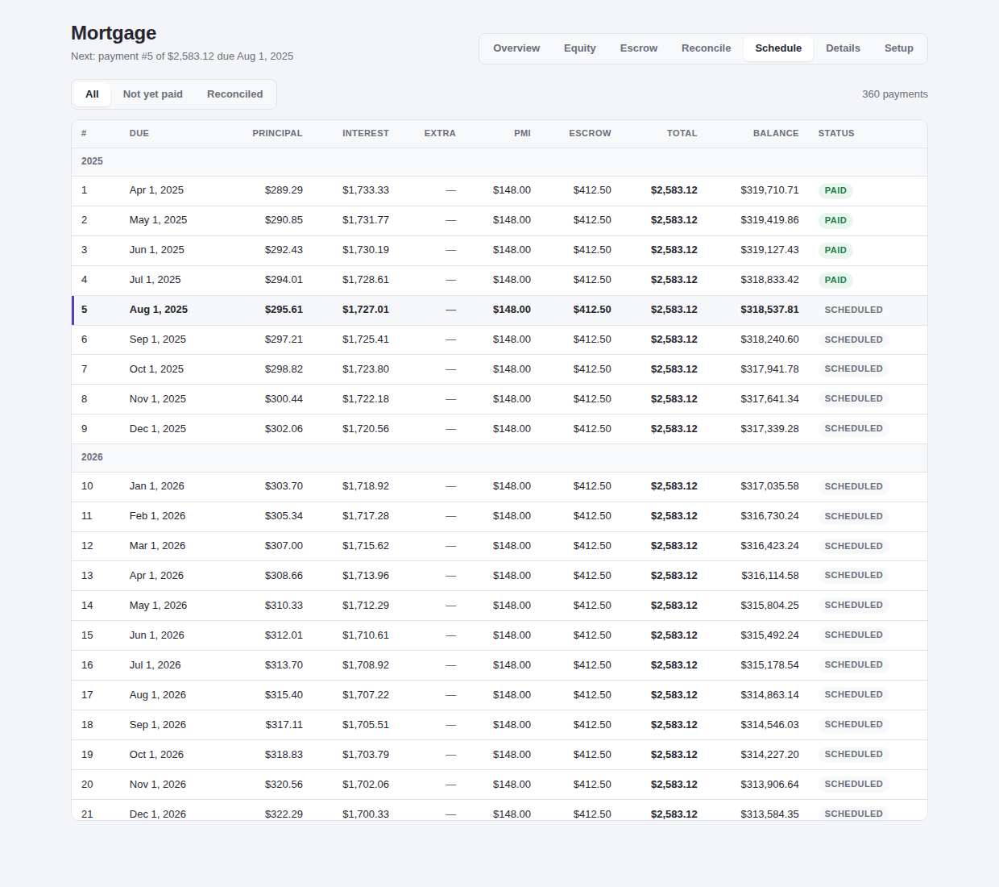

</details>

### Example: a car loan

A $30,000 loan at 6.9% for 60 months on a $36,000 hatchback, with $6,000
down and a $299 processing fee, using daily simple interest. After six
payments you owe $27,439.32. A September pricing guide values the car at
$32,500, so equity is **$5,061**. The car is set to lose an estimated 15% a
year, so the equity chart follows that curve, and the screen shows the
projected value today ($32,112) next to the value you entered.

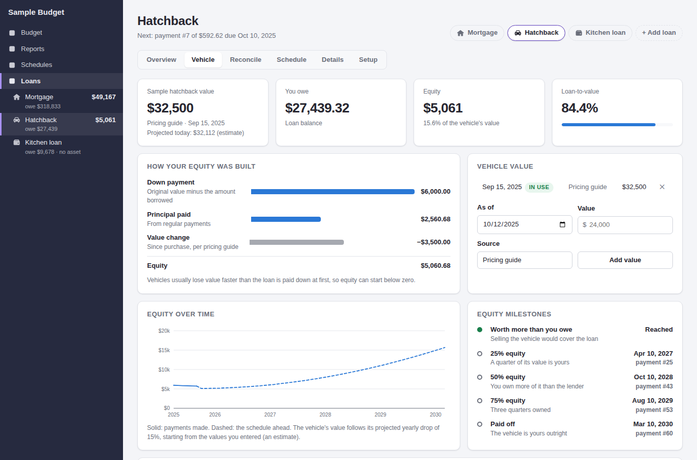

A personal loan with no asset gets a payoff card and a **Totals** screen
instead:

<details>
<summary>Personal loan overview</summary>

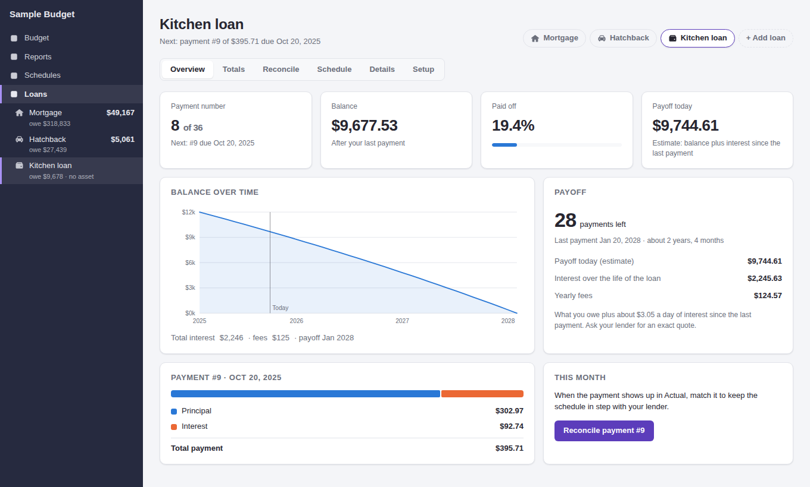

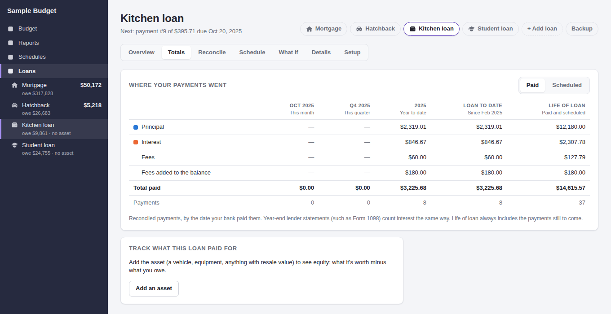

</details>

It follows Actual's light and dark theme and **privacy mode**: with privacy
mode on (the eye icon in Actual's top bar), every dollar amount on the loan
screens and in the sidebar list turns into Actual's privacy squiggle until
you hover over it.

<details>
<summary>Privacy mode</summary>

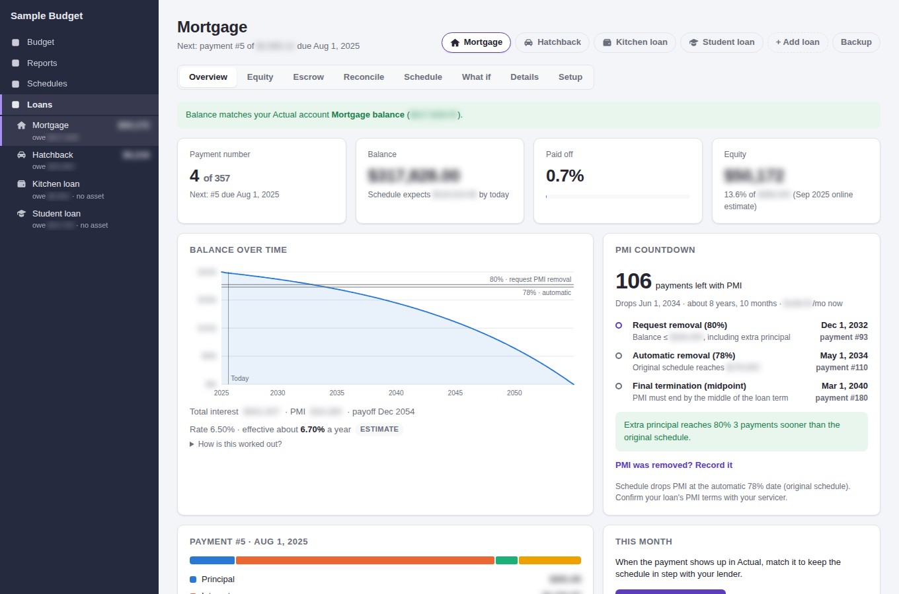

</details>

<details>
<summary>Dark theme</summary>

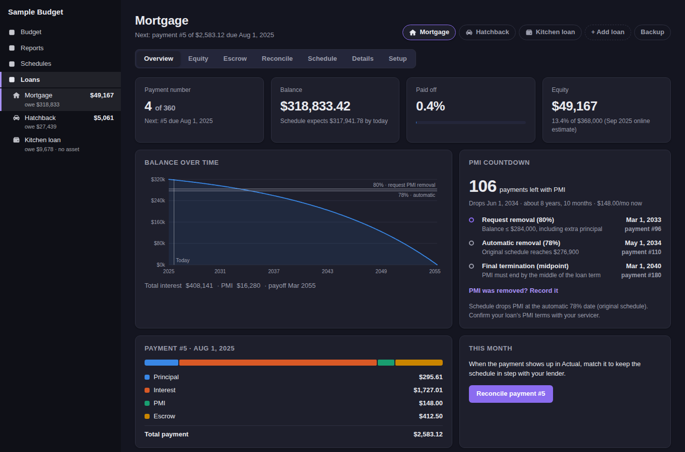

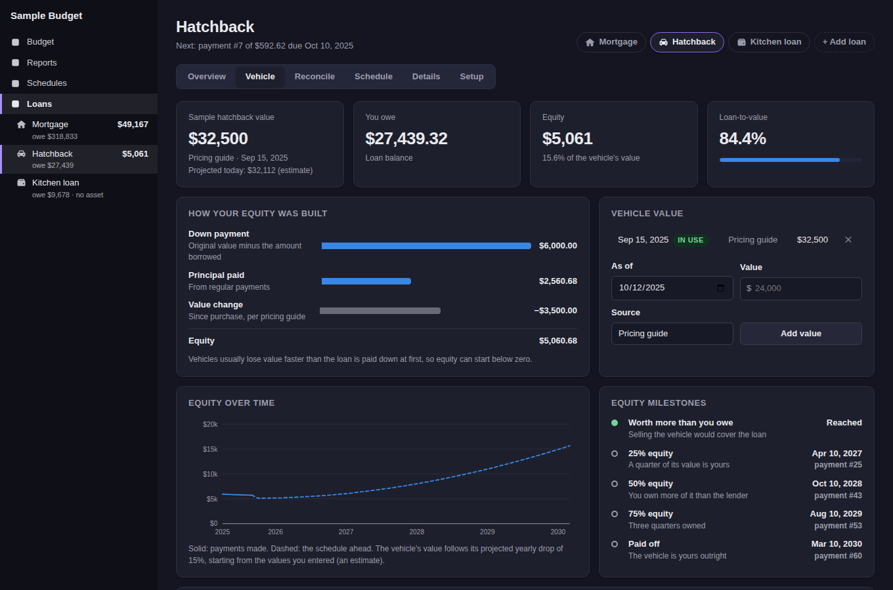

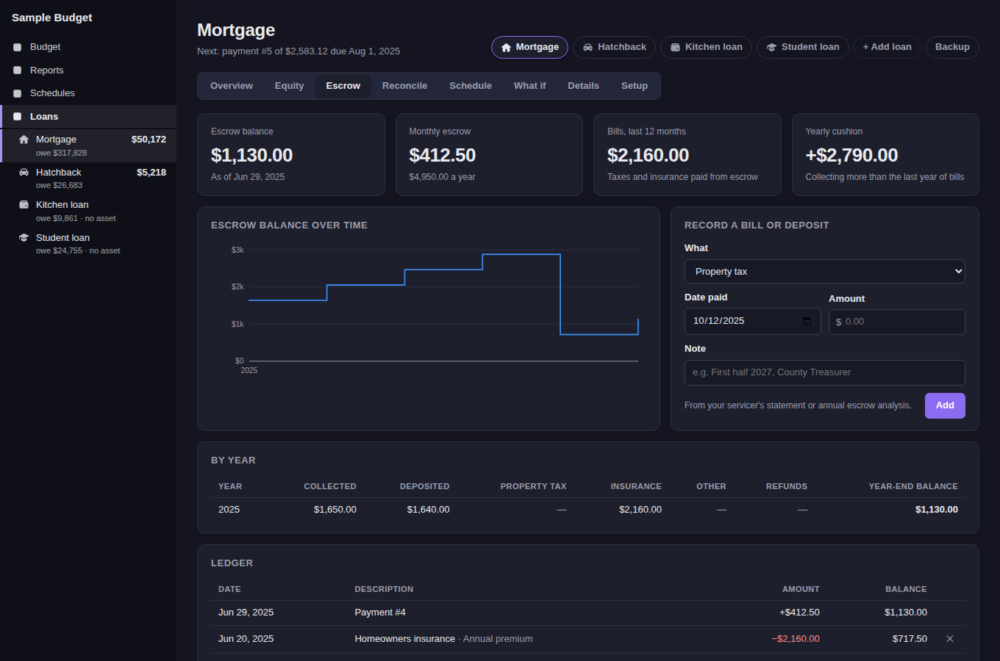

</details>

Under the hood:

- **The schedule generates itself** from the setup and rolls forward month
  by month. Reconciled months are *locked*: their real amounts are frozen,
  and later months recalculate from them.
- **Money is exact.** Everything is stored in whole cents (Actual's own
  unit), so the schedule matches your statement to the penny.
- **Read-only toward Actual.** The tracker reads categories and
  transactions through the official [`@actual-app/api`](https://actualbudget.org/docs/api/)
  and keeps its own data in a small SQLite file in `data/`. No code path in
  the tracker writes to your budget.

---

## Using it

### Adding a loan

Open **Loans** and click **+ Add loan** (with no loans yet, the welcome
screen starts there). Pick the type:

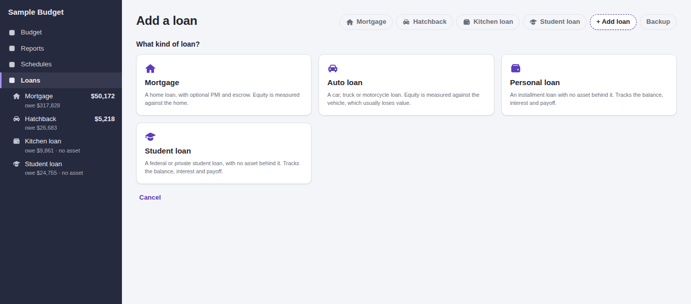

Then fill in only what that type needs:

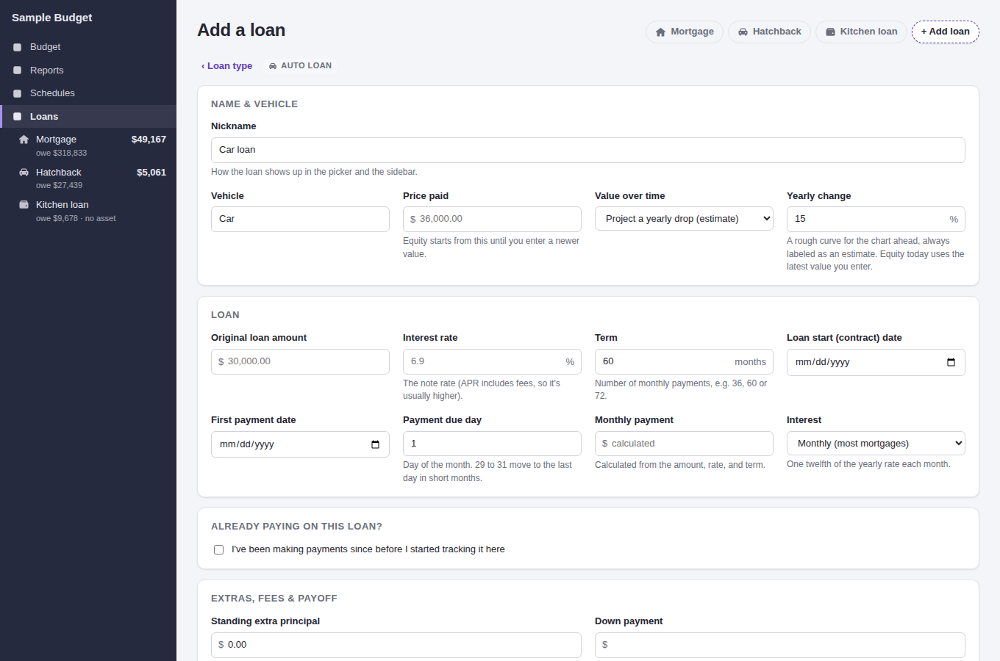

Fields every loan has, from its paperwork:

| Field | Notes |
|---|---|
| Nickname | How it shows in the picker and the sidebar. |
| Original loan amount | The amount borrowed. |
| Interest rate | The note rate as an annual percent, e.g. `6.5`. Not the APR, which includes fees. |
| Term | Years for a mortgage; number of monthly payments for other loans. |
| Loan open date | Closing or contract date. Must be on or before the first payment. |
| First payment date | From the note or the first statement. |
| Payment due day | Day of the month. 29 to 31 move to the last day of short months. |
| Monthly payment (P&I) | Left blank, it's calculated with the standard formula. If your statement differs by a cent, type the statement's exact amount here. |
| Interest | Monthly (most mortgages) or daily simple interest (many car and personal loans). See [Interest: monthly or daily](#interest-monthly-or-daily). |
| Standing extra principal | Added to every payment, 0 if none. |
| Already paying on this loan? | For a loan you've been paying for a while. See [below](#a-loan-thats-already-under-way). |

What the loan paid for (the **asset**):

| Field | Notes |
|---|---|
| Name | e.g. *Home*, *2024 hatchback*. |
| Purchase price | Equity starts from this until you enter a newer value. |
| Value over time | *Only the values I enter*, or a projected yearly drop or rise (an estimate, used for the chart). |

Mortgage only:

| Field | Notes |
|---|---|
| PMI on/off, monthly PMI, PMI start date | A blank start date means PMI starts with the first payment. |
| Original home value (for PMI) | Starts as the purchase price. Lenders usually use the **lower of the purchase price and the appraisal**, so check yours and change it under Setup if needed. It moves every PMI date. |
| When to drop PMI | See [PMI](#pmi-mortgages). |
| Escrow on/off, monthly escrow | Taxes and insurance collected with the payment. |

<details>
<summary>The Setup screen of a mortgage</summary>

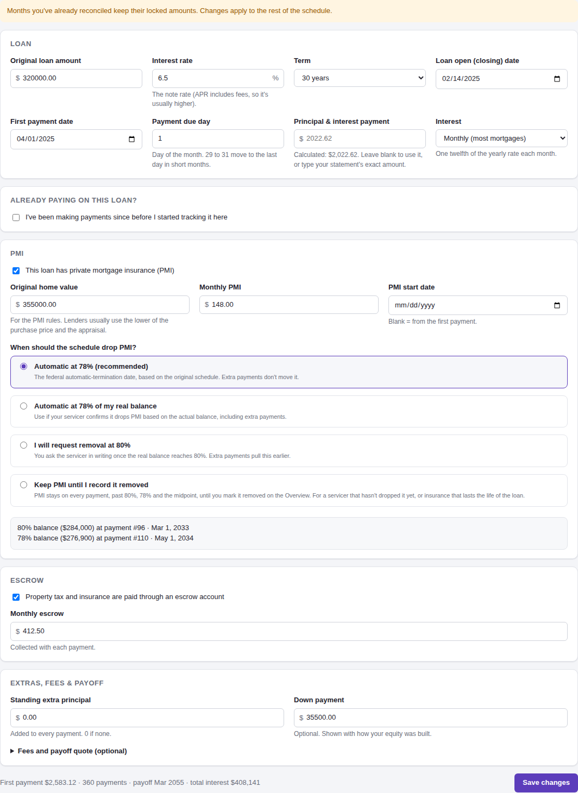

</details>

Optional, any loan (under **Fees and payoff quote**):

| Field | Notes |
|---|---|
| Down payment | Shown with how your equity was built. |
| One-off fees | Processing, origination, credit insurance and the like. Mark whether each was added to the loan. Counted in the cost of the loan. |
| Yearly fee | A percent of the original amount or of the remaining balance, charged with the first payment of each loan year (payments 1, 13, 25 and so on). Part of that month's payment. |
| Payoff quote | An amount from your lender and its good-through date. Used for *payoff today* instead of the estimate until it expires. |

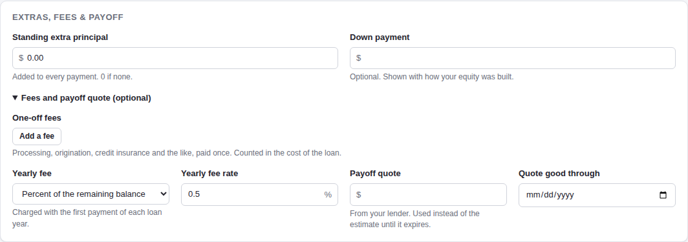

A yearly fee shows up in its own column on the Schedule:

<details>
<summary>Schedule with a yearly fee</summary>

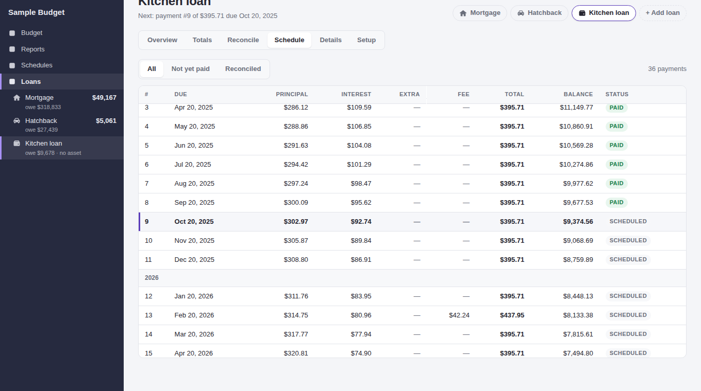

</details>

The final payment absorbs the few cents of rounding left at the end of the
term, the way lenders do it, so it can differ slightly from the others.

Paid off or sold? **Archive** the loan under Setup to hide it from the
picker, the sidebar and the summary while keeping its history. **Delete**
removes it and everything recorded for it (you type its name to confirm).

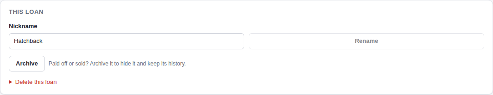

#### A loan that's already under way

If you've been paying on the loan for years, you don't have to reconcile
every month since it started. On the Setup screen:

1. Enter the **original** terms from your loan documents, as above. Use
   today's monthly escrow, and today's PMI (0 if it's gone).
2. Tick **Already paying on this loan?** and enter, from a recent statement,
   the **due date of your last payment** and the **principal balance after
   it** (the unpaid principal, not the payoff amount).

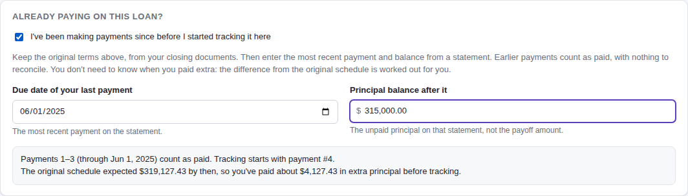

Every payment up to that one is marked **Before tracking**: it counts as
made, with the original schedule's amounts, and has nothing to reconcile.
Reconcile starts with the next payment, and the payment number, percent
paid, equity and life-of-loan totals stay measured from the original loan.

You don't need to know when you paid extra principal. Whatever the original
schedule doesn't explain is recorded as **extra before tracking**. The
interest on payments before tracking comes from the original schedule, so
it's an estimate (a little high if you paid extra back then). If your
balance comes out *higher* than the original schedule by more than a few
dollars, check the rate, term and payment; a loan modification or an
adjustable rate can't be modeled this way.

For a mortgage with escrow, the escrow ledger starts empty. Add your escrow
balance from the same statement as a **Deposit** on the Escrow screen.

### The monthly routine

Once a month, after your bank has synced the payment into Actual:

1. Open the loan and go to **Reconcile**. It opens the first unpaid month.
2. The first time, **pick the category** this loan's payments are booked to
   in Actual (it's remembered per loan).
3. The screen lists transactions in that category within about three weeks
   of the due date, exact matches first. **Click the right one.**

   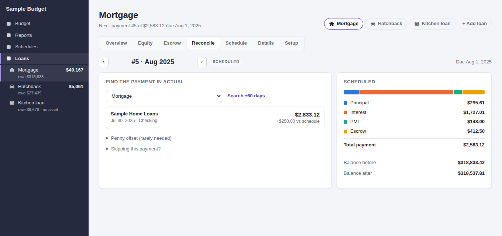

4. **If the amount matches the schedule,** the month flips to **Paid**, its
   real amounts are locked, and you're done.
5. **If it differs,** the month is **Flagged** and you're asked what the
   difference is:

   | Answer | What changes |
   |---|---|
   | **Rounding offset** | Up to $1.00. The cents go to this month's principal only. |
   | **Extra principal** | The extra goes to the balance this month. Tick *keep paying this every month* to make it a standing extra. Later interest and the payoff date recalculate. |
   | **Escrow changed** | Mortgages with escrow. New escrow amount from this month on, typically after your yearly escrow analysis. |
   | **PMI changed** | Mortgages with PMI. New PMI amount from this month on. If the servicer stopped charging PMI, this records it at $0. |

   

   The answer that fits best is highlighted, and answers that can't explain
   the difference are disabled. Afterwards the month is marked **Paid**.
6. Made a mistake? **Undo reconciliation** on a paid month (or **Unmatch**
   on a flagged one) removes the match *and* any schedule change it made.

**Penny offset.** Rarely, a lender's interest split differs by a cent
without the total changing. Each unreconciled month has a small *Penny
offset* field (under the transaction list) for that.

**Missed a month?** Months don't have to be reconciled in order. The
Schedule screen shows every month's status; click any row to reconcile it.

### Skipping a payment

If your lender approves skipping a payment (a hardship grace period, a
skip-a-payment offer, forbearance, or a deferral), open that month in
**Reconcile**, expand **Skipping this payment?**, and pick how your lender
handles it:

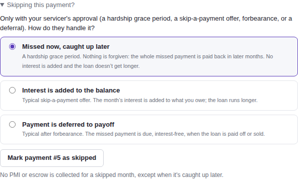

| Choice | What the schedule does |
|---|---|
| **Missed now, caught up later** | You miss payments for a while and pay them back later. Nothing is forgiven. The whole missed payment (including PMI and escrow on a mortgage) becomes *past due*. No interest is added and the loan's length doesn't change. |
| **Interest is added to the balance** | Nothing is paid that month. The month's interest is added to what you owe, the same monthly payment continues, and the loan runs a little longer. Typical of skip-a-payment offers. |
| **Payment is deferred to payoff** | Nothing is paid that month. The missed principal and interest go into a separate, interest-free balance due in one lump sum at payoff (or when the asset is sold). Typical after forbearance. |

**Catching up.** For a *missed now, caught up later* month, set a
**catch-up plan** on the same screen: *starting with* a later payment,
*spread over* a number of payments (1 pays it all at once). Consecutive
missed months share one plan. Until you set one, the past-due amount is held
until the final payment. You can change or remove the plan any time.

A skipped month has no bank transaction, so it counts as done once its due
date passes. Equity counts deferred and past-due amounts as still owed. A
yearly fee that falls on a skipped month moves to the next payment made.
**Undo skip** removes a skip. Lenders differ, so check your approval letter.

### Equity, assets and values

**Equity is the asset's value minus what you owe** (the balance plus any
deferred or past-due amounts). The value is the latest one you've entered on
the value screen (an appraisal, a tax assessment, a pricing guide, an online
estimate), or the purchase price until you enter one. A value of 0 is
allowed, for a car that was totaled or anything written off.

**Projected value.** An asset can also have a yearly trend: a drop for
vehicles (15% a year is offered as a starting point) or a rise for a home.
The projection is only an estimate. It shapes the equity chart (starting
from the values you entered) and shows a *projected today* figure next to
your latest value; the headline equity always uses the value you entered.
Set it on the value screen, where you can also rename the asset and change
what it cost:

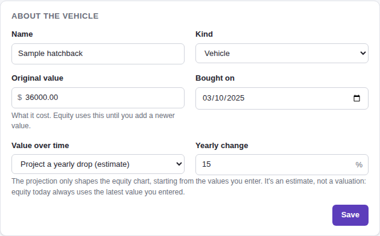

**Vehicles** usually lose value faster than the loan is paid down at first,
so equity can start below zero. The first milestone for a vehicle is *worth
more than you owe*.

**Where your payments went.** The table on the value screen has two modes.
*Paid* counts reconciled payments by the date your bank paid them, the same
way a year-end lender statement (such as Form 1098) counts interest.
*Scheduled* counts every payment by its due date. The *Life of loan* column
always includes the payments still to come.

**Payoff today** (on loans without PMI, and in the summary) is your lender's
payoff quote while it's good, or else an estimate: what you owe plus simple
interest per day since the last payment. Ask your lender for an exact quote
before paying a loan off.

**Escrow** (mortgages). Escrow from each reconciled payment is added
automatically. The bills it pays never pass through your bank, so record
them from your servicer's statements: property tax, homeowners or flood
insurance, HOA dues, other bills, surplus refunds, and deposits (the initial
escrow deposit at closing, or a shortage payment). The *Yearly cushion*
compares a year of collections at today's monthly amount with the bills paid
in the last 12 months; a negative cushion usually means your payment will go
up at the next escrow analysis.

**Loan details.** The **Details** screen is for reference information. It's
stored only in the add-on's database, never sent to Actual, and never
included in the summary endpoint. Account, policy, VIN and certificate
numbers stay masked until you click into them. The fields follow the loan
type:

<details>
<summary>Details for a mortgage and for a car loan</summary>

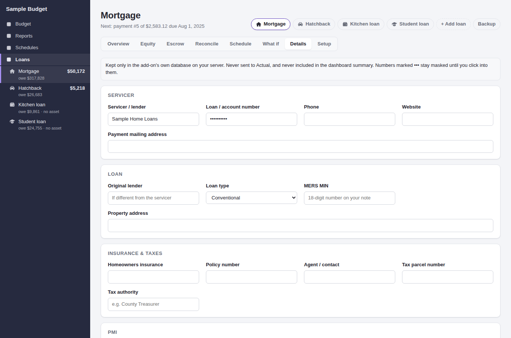

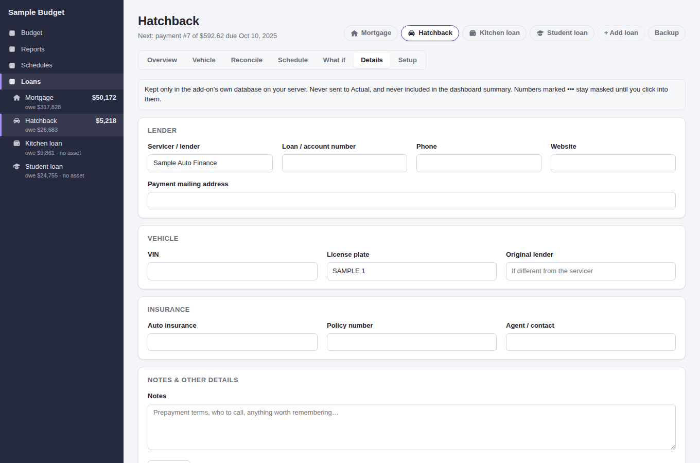

</details>

### Interest: monthly or daily

Each loan uses one of two methods, chosen under Setup:

- **Monthly** (the default; how most mortgages are serviced): each month's
  interest is the balance times the yearly rate divided by 12.
- **Daily simple interest** (common for car and personal loans): each
  payment's interest is the balance times the yearly rate divided by 365,
  times the days since the previous payment (from the loan open date for the
  first). Once a payment is matched to a bank transaction, **the date your
  bank paid it is used**: paying a few days early means less interest and
  more principal that month. Extra principal sent with a payment lowers the
  balance from that day. The scheduled last payment settles whatever is
  left, so it can differ from the others.

Daily interest uses a 365-day year, including in leap years. See
[Known limitations](docs/KNOWN_LIMITATIONS.md) for lenders that count days
differently.

### PMI (mortgages)

> **Confirm your own loan's terms.** The first three rules below assume a
> **conventional** U.S. loan, where PMI follows the Homeowners Protection
> Act. FHA (MIP), VA, USDA, and lender-paid PMI follow different rules; for
> insurance that lasts the life of the loan, use *Keep PMI until I record it
> removed*.

- **At 80% of the original home value** you may *ask* the servicer to cancel
  PMI. Extra principal gets you there sooner.
- **At 78% of the original home value, on the *original* schedule,** PMI
  must end *automatically*, as long as you're current. Extra payments don't
  move this date.
- **At the midpoint of the term** (e.g. payment 180 of 360) PMI must end
  regardless.

The PMI countdown shows all three dates and how many payments sooner extra
principal gets you to 80%. Under Setup you choose when the schedule drops
PMI:

| Setting | Schedule removes PMI after… |
|---|---|
| **Automatic at 78% (recommended)** | the payment where the original schedule reaches 78%. |
| Automatic at 78% of my real balance | your real balance (with extras) reaches 78%. Only if your servicer confirms they do this. |
| I will request removal at 80% | your real balance reaches 80%. Pick this once you plan to send the request. |
| Keep PMI until I record it removed | nothing: PMI stays on every payment, past 80%, 78% and the midpoint, until you record that it was removed. |

With the first three settings, PMI doesn't stay on the schedule past the
78% automatic date or the midpoint. Plenty of real loans don't work that
way: the servicer is slow to drop it, you weren't current when the date
came, or the insurance lasts the life of the loan. Pick **Keep PMI until I
record it removed** for those, and the countdown shows what you pay each
month instead of a drop date, plus a reminder once you've passed 80% and can
ask for cancellation.

**When PMI actually comes off**, record it on the Overview under the PMI
countdown: *PMI removed? First payment without it*, then **Record
removal**. It works with every setting, so it also covers PMI removed early
on a new appraisal. **Undo** takes it back. A month you've already
reconciled keeps the PMI it really paid, so the removal has to start after
the last reconciled month.

You can also let reconciling find it: when a payment comes in short by the
PMI amount (or still includes PMI after the schedule dropped it), answer
**PMI changed** for that month. No PMI at all? Turn it off under Setup.

### Backing up and restoring

Click **Backup** at the end of the loan tabs (on a fresh install, use
*Restore a backup* under the welcome form).

- **Download backup** saves everything in the tracker as one file, named
  like `ab-asset-tracker-backup-2026-10-28.json`: every loan (archived ones
  too) with its setup, category, reconciled months, skips, catch-up plans,
  escrow entries and details, and every asset with its value history.
- **Restore** loads a backup file. You see what's in it (when it was made,
  which loans) before anything changes, then **Replace with this backup**
  swaps it in. Restoring replaces everything in the tracker, so first a copy
  of the current database is saved in `data/` as
  `*.sqlite.backup-before-restore-<time>` (skipped when the tracker is
  still empty).

A backup made by an older version of the tracker restores into a newer one;
it's upgraded on the way in. Loans keep their ids, so a dashboard using
`?loan=<id>` keeps working after you move to a new install.

What a backup doesn't include: your Actual budget (back it up in Actual,
*Settings → Export data*), and your `.env` settings and passwords. The file
is plain JSON and holds what you typed under Details, such as loan and
policy numbers, so keep it somewhere private.

**Moving to a new machine:** download a backup, install the tracker on the
new machine, open it, click *Restore a backup* and pick the file.

**From the command line** (for scripts or a nightly backup), run these from
the `ab-asset-tracker` folder while the tracker is running:

```sh
# Back up
docker compose exec -T -u node asset-tracker-backend node dist/server/backup-cli.js export > tracker-backup.json

# Restore (replaces everything, after saving a copy of the current database)
docker compose exec -T -u node asset-tracker-backend node dist/server/backup-cli.js import < tracker-backup.json
```

For example, a nightly backup with `crontab -e`:

```
15 2 * * * cd /path/to/ab-asset-tracker && docker compose exec -T -u node asset-tracker-backend node dist/server/backup-cli.js export > backups/tracker-$(date +\%F).json
```

(Create the `backups` folder first.)

---

## Configuration reference

All settings live in `.env`; `.env.example` documents each one. `.env` is
gitignored, so it never ends up in the repo. The backend checks its
settings at startup and stops with a message naming anything missing or
invalid. After changing `.env`, run `docker compose up -d`.

| Setting | Required | Default | What it is |
|---|---|---|---|
| `COMPOSE_FILE` | **yes** | `compose.existing-actual.yml` | Which setup: `compose.existing-actual.yml` (A) or `docker-compose.yml` (B). |
| `ACTUAL_SERVER_URL` | **yes** | none | How the backend reaches Actual **from inside Docker**. |
| `ACTUAL_UPSTREAM` | **yes** | none | Where the proxy sends normal Actual traffic. Almost always the same as `ACTUAL_SERVER_URL`. |
| `ACTUAL_PASSWORD` | **yes** | none | Your Actual server password. |
| `ACTUAL_SYNC_ID` | **yes** | none | Which budget to read. |
| `ACTUAL_BUDGET_PASSWORD` | no | empty | Only if the budget uses end-to-end encryption. |
| `ACTUAL_CA_CERT` | no | empty | Path *inside the backend container* to Actual's certificate, if it's self-signed. See [below](#actual-uses-a-self-signed-certificate). |
| `PROXY_PORT` | no | `5007` | The port you open in the browser. Prefix an address to listen only there, e.g. `127.0.0.1:5007`. |
| `PROXY_TLS` | no | `on` | `off` serves plain HTTP, for a [Cloudflare Tunnel or reverse proxy](#behind-a-cloudflare-tunnel-or-another-https-proxy) that handles HTTPS. |
| `ACTUAL_CERT_DIR` | no | `./certs` | Host folder with the proxy's certificate and key (and Actual's CA cert, if any). |
| `TLS_CERT_FILE` / `TLS_KEY_FILE` | no | `tls.crt` / `tls.key` | File names of the proxy's certificate and key inside `ACTUAL_CERT_DIR`. |
| `ACTUAL_DATA_DIR` | no | `./actual-data` | Setup B only: where Actual stores its data. |
| `ACTUAL_IMAGE` | no | `docker.io/actualbudget/actual-server:latest` | Setup B only: which Actual image to run. Pin a tag to update on your own schedule. |
| `BACKEND_PORT` | no | `3100` | Port the backend listens on inside the Docker network. |
| `SUMMARY_TOKEN` | no | empty (off) | Turns on the [read-only summary endpoint](docs/SUMMARY_ENDPOINT.md). |
| `TZ` | no | `Etc/UTC` | Your timezone as a tz database name, used to decide what "today" is. |

The tracker's own data lives in `./data`:

| File | What it is |
|---|---|
| `asset-tracker.sqlite` | Loans, setup, reconciliation, assets. **Back this up.** |
| `*.sqlite.backup-v<N>-<time>` | A copy made automatically before an update changed the database layout. Safe to delete once you're happy. |
| `*.sqlite.backup-before-restore-<time>` | The data a restore replaced, saved just before it. Safe to delete once you're happy. |
| `actual-cache/` | A local copy of the budget that the tracker downloads from Actual. Safe to delete; it's downloaded again. |

### Use a real certificate

The self-signed certificate is fine on a home network, but every new browser
warns about it. To avoid that, give the proxy a certificate your browsers
already trust:

- **A public name** (for example from Let's Encrypt, via certbot or your
  router or NAS): copy the full chain and the private key into `certs/`,
  then set `TLS_CERT_FILE=fullchain.pem` and `TLS_KEY_FILE=privkey.pem` in
  `.env` (or name the files `tls.crt` and `tls.key`). The name you open in
  the browser must match the certificate.
- **A local name** (for example with [mkcert](https://github.com/FiloSottile/mkcert)
  or your own small CA): create a certificate for the host name you use, put
  it in `certs/` the same way, and install the CA on your devices.

Then run `docker compose restart asset-tracker-proxy` (after every renewal
too). The proxy never overwrites certificate files that are already there.

### Actual uses a self-signed certificate

The backend has to trust Actual's certificate to read your budget:

1. Copy Actual's certificate into this folder's `certs/`, e.g.
   `certs/actual-ca.crt`.
2. Set `ACTUAL_CA_CERT=/certs/actual-ca.crt` in `.env` (that's the path
   inside the container).
3. Make sure the certificate lists the host name used in
   `ACTUAL_SERVER_URL` (with setup A, usually `actual`).
4. Run `docker compose up -d`.

---

## How it works

```
 browser ──HTTPS──▶  asset-tracker-proxy (nginx) ──▶  Actual (stock image, untouched)
   (or a Cloudflare Tunnel / reverse proxy in front, with PROXY_TLS=off)
                         │
                         ├── /asset-tracker-addon/*  ─┐
                         └── /asset-tracker-api/*    ─┴─▶ asset-tracker-backend (Node) ──read-only──▶ Actual API
```

1. **The proxy passes everything through.** Every request goes to Actual
   as-is. The only change: on Actual's HTML pages it adds one line just
   before `</head>`:
   ```html
   <script src="/asset-tracker-addon/inject.js" defer></script>
   ```
   The script is served from the same address as Actual, which Actual's own
   security policy already allows.
2. **The script finds the sidebar defensively.** It looks for Actual's
   sidebar links by their addresses (`/schedules`, then `/reports`, then
   `/budget`), copies one so the new item matches Actual's look and theme,
   and inserts **Loans** right after it, with the list of loans below. React
   redraws the sidebar often, so a watcher puts them back when they
   disappear.
3. **Clicking it opens the screens beside the sidebar,** inside Actual's
   window, in an isolated layer (a *shadow root*) so Actual's styles and the
   tracker's can't interfere. The address gets `#loans` added: Back closes
   the screens, Forward reopens them, and a reload or bookmark opens them
   again. Clicking any other sidebar item takes you back to Actual.
4. **It fails quietly.** If Actual's page changes so much that no sidebar
   link can be found, the script adds nothing and logs one line to the
   browser console. Actual keeps working exactly as before.
5. **Who can see the data?** The backend only answers requests that carry a
   valid Actual login. The script reads the session token Actual's web app
   already keeps in your browser, and the backend checks it with your Actual
   server (`/account/validate`).

---

## Support the project

AB Asset Tracker is free and open source, and it stays that way: nothing is
locked behind a payment. If it saves you time each month, any of these
helps:

- **Chip in on [Patreon](https://patreon.com/IvanS1123).** Support goes
  toward the time spent on new features (see the
  [roadmap](docs/ROADMAP.md)), fixes and testing against new Actual releases.
- **Star the repository** on GitHub, so other Actual users can find it.
- **Report bugs or ideas** in an issue. Real loans turn up cases no test
  covers.

Thank you!

---

## License

MIT. See [LICENSE](LICENSE). Not affiliated with or endorsed by the Actual
Budget project.
